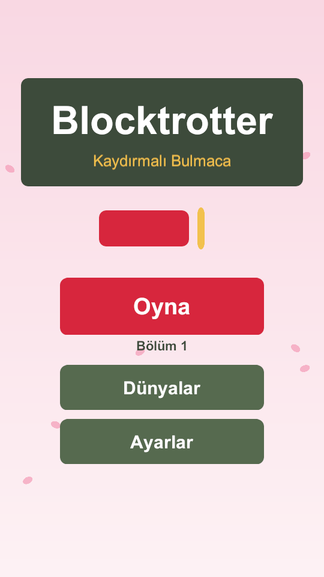
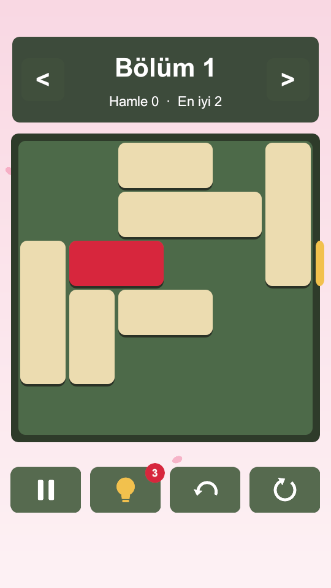
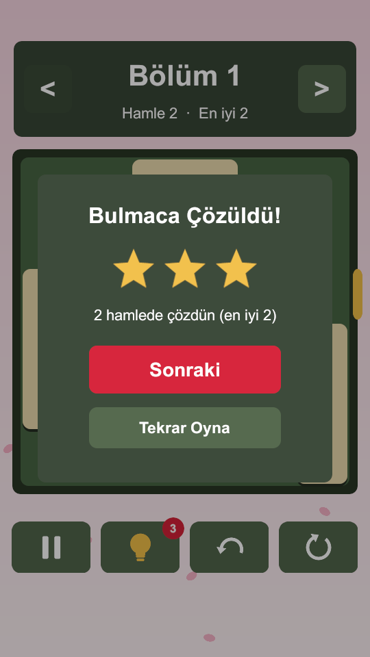
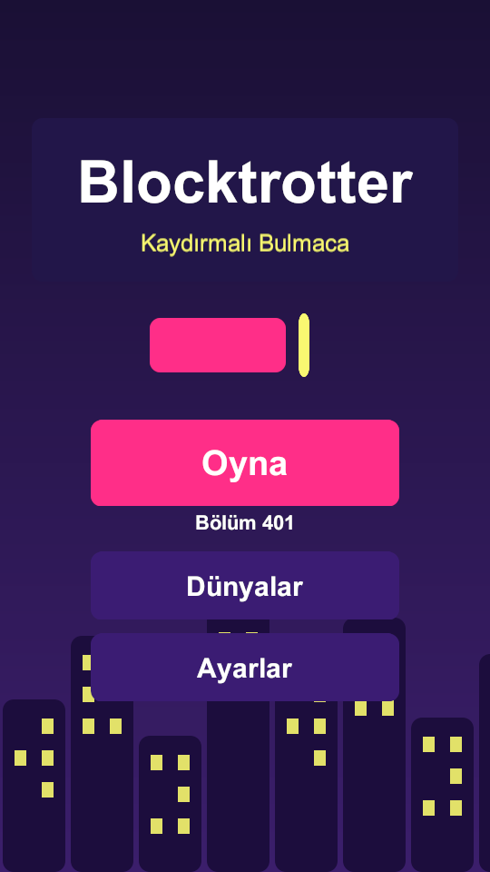
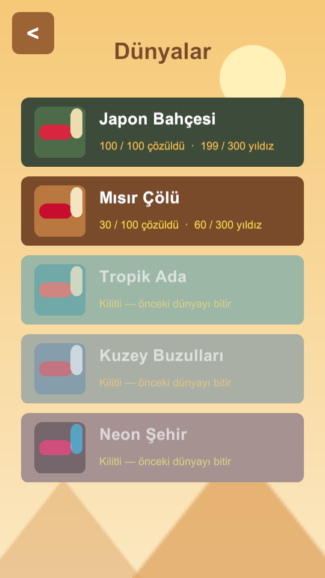
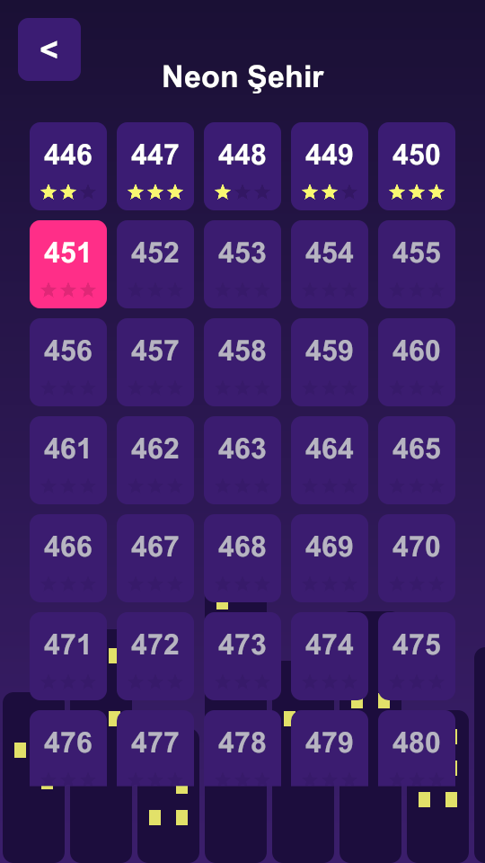
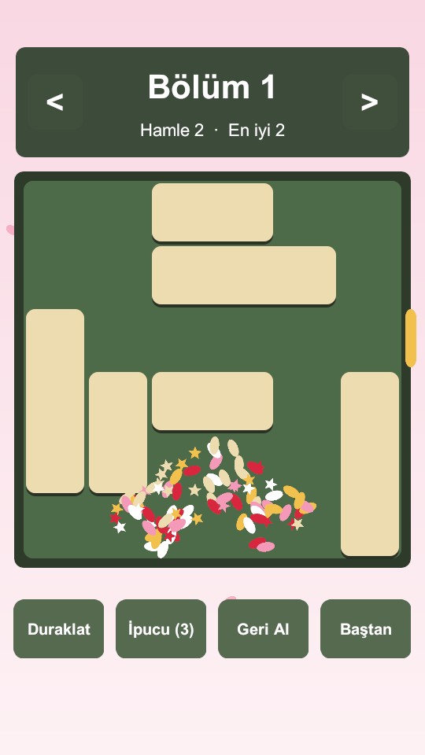
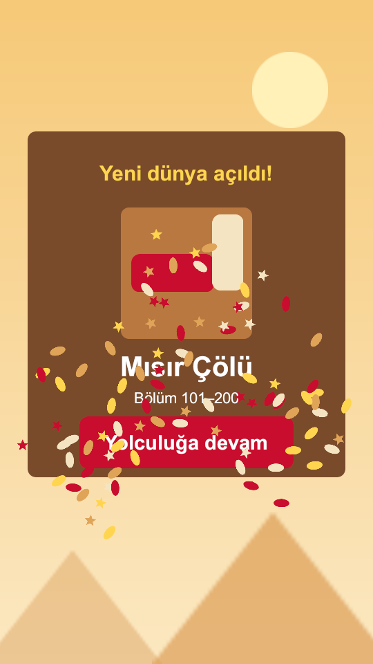

# Blocktrotter: Slide Puzzle

A sliding-block puzzle game for iOS (Android later), built in **Unity 6.3 LTS** with C#.
Slide the blocks out of the way and guide the red block to the exit — across **5 worlds** and **500 levels**,
in English and Turkish.

  
  
  
  

## Features

- **500 original levels**, generated and verified by the game's own solver — easiest first (2 moves) to hardest (30 moves).
- **5 worlds**, one every 100 levels: Japanese Garden, Egyptian Desert, Tropical Island, Arctic Glaciers, Neon City — each with its own palette and animated background (falling petals, pyramids, waves, snow, a neon skyline).
- **1–3 stars** per level based on moves versus the optimal solution; unlocks, best stars and hints are saved on the device.
- **Hints** that play the next optimal move, **undo** and **restart**.
- **Celebration**: confetti, a pop-in "Puzzle solved" panel with stars appearing one by one, and a "New world unlocked!" screen.
- **English and Turkish**, picked from the device language and switchable in Settings.
- **Ads (Google AdMob)**: a banner on the main menu only, an interstitial every 5 solved levels (on the player's tap, never mid-puzzle) and an optional rewarded ad for a hint — with Google UMP consent and Apple App Tracking Transparency.
- **No third-party art**: every block, icon, star, confetti piece and background decoration is drawn in code.

## How it works

| Area | What's there |
|---|---|
| **Puzzle core** (`Assets/_Game/Core`, plain C#, no Unity dependency) | `Board` (move legality, win check), `BoardSolver` (breadth-first search over a packed 64-bit state; also powers hints), `GameSession` (moves, undo, restart, hints), `StarRating`, `AdPolicy`, `LevelCodec` (36-character level strings). |
| **Level generation** | `StateCluster` explores every position reachable from a random board and labels each with its distance to a solved position; `LevelSetGenerator` picks positions at exactly the move counts a difficulty curve asks for. Seeded, so the same settings always produce the same 500 levels. Run from the editor: *Blocktrotter › Generate Levels*. |
| **App & screens** (`Assets/_Game/Runtime`) | One scene; screens (main menu, worlds, level grid, game, settings, world unlocked) are built in code under a safe-area-aware canvas. |
| **Data-driven tuning** | `GameConfig`, `ThemeDefinition` ×5, `AdConfig`, `LevelDatabase` ScriptableObjects — gameplay and feel values live in assets, not code. |
| **Ads** | `IAdService` with an editor stand-in; the AdMob implementation sits in an optional assembly that compiles only when the Google Mobile Ads package is installed. |
| **Tests** (`Assets/Tests/EditMode`) | 63 NUnit tests: board rules, solver, generator determinism, every one of the 500 levels solved and replayed, progress saving, ad pacing, localization tables. |

  
  
  
  

## Running it

1. Open the folder in **Unity 6000.3.26f1** (Unity Hub › Add project from disk).
2. Press Play — the editor always starts from `Assets/_Game/Scenes/Game.unity`. Ads appear as grey "TEST" placeholders in the editor.
3. Tests: *Window › General › Test Runner › EditMode › Run All*.

Ads use Google's public **test** ad unit IDs until release.

## Legal

[Privacy Policy](https://fruthbtw.github.io/blocktrotter/privacy-en.html) · [Terms of Service](https://fruthbtw.github.io/blocktrotter/terms-en.html)
([Türkçe](https://fruthbtw.github.io/blocktrotter/privacy-tr.html))

## License

**Copyright © 2026 Yunus Emre Uludağ. All rights reserved.**
The source is published so it can be read as a portfolio piece. No licence is granted to copy, modify, distribute or publish the game or its code.

Developed with [Claude Code](https://claude.com/claude-code) as a pair-programming assistant.
